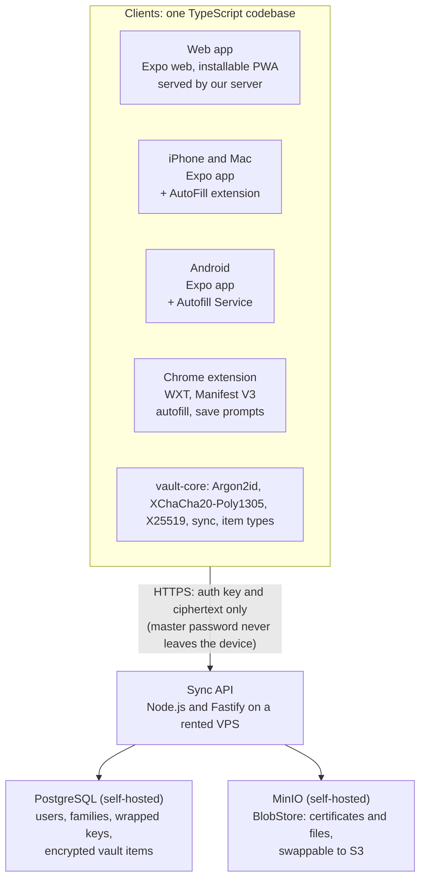
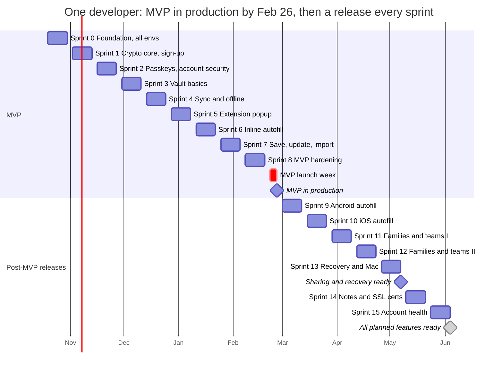

# Hearthkey: Tech Stack, SDLC and Sprint Plan

2026-10-10 · Suman Gummalla

> Committed from the published plan doc: https://claude.ai/code/artifact/6d702435-7c7e-4d03-a5a4-68be88a2e332

## Summary

Hearthkey is built as one TypeScript monorepo: Expo (React Native) for iPhone, Android and web, a Manifest V3 Chrome extension built from the same shared vault core, and a small Node.js API over PostgreSQL on a rented VPS that only ever stores encrypted data. With one developer working in 2-week sprints, the MVP reaches production in the week of **2027-02-22**, after Sprint 0 plus 8 sprints: accounts protected by passkeys, the vault on web and phones, and the Chrome extension with autofill, save and update prompts. After that, each sprint ships one more feature to production: phone autofill, then families and teams with organizer or manager recovery and Mac (around 2027-05-07), notes and SSL certificates, and account health, finishing in early June 2027.

All seven planning decisions are made; none are open.

### Decisions needed from Suman

| # | Decision | Status | Choice |
| --- | --- | --- | --- |
| 1 | App name | Decided | Hearthkey |
| 2 | Cross-platform framework | Decided | Expo / React Native, sharing TypeScript with the extension |
| 3 | Mac app | Decided | iPad app running on Apple Silicon Macs, plus the web app and extension |
| 4 | Forgotten master password | Decided | A family organizer or team manager can recover a member who opted in (design under Security design); everyone else relies on their recovery kit |
| 5 | Secret Key (1Password-style) | Decided | No Secret Key; passkeys as the second factor instead (see Security design). Can be revisited after launch |
| 6 | Hosting | Decided | Production on a rented VPS (Hostinger, 2 vCPU, 8 GB RAM, 100 GB disk) running the API, PostgreSQL and MinIO; staging on Fly.io; storage swappable to cloud later (see [ADR-0001](adr/0001-hosting-fly-staging-vps-production.md)) |
| 7 | Team and timeline | Decided | 1 developer; Sprint 0 starts 2026-10-19, MVP in production the week of 2027-02-22 |

Developer accounts must be opened in Sprint 0: Apple Developer Program (about $99 a year), Google Play Console (about $25 once) and Chrome Web Store (about $5 once). These prices are from memory, so treat them as approximate.

## Technology stack

The deciding factor is one language everywhere: the encryption code runs in the app, the web app and the Chrome extension, and in a password manager that code must be identical on every platform. TypeScript is the only language that runs natively in all three, so the stack is built around a shared `vault-core` package.

*Every client encrypts on the device; the server stores only ciphertext.*

All four clients carry the same vault-core, so encryption happens before anything reaches the API.

| Layer | Recommendation | Why | Trade-off |
| --- | --- | --- | --- |
| Repository | pnpm workspaces + Turborepo monorepo | One repo for apps, extension, API and shared packages; cached builds | Bigger repo to learn at first |
| Shared core | `vault-core` TypeScript package: crypto, item types, sync, domain matching | Written and tested once, used by every client | Must stay free of platform APIs (adapters per platform) |
| iPhone, Android, web | Expo SDK with Expo Router, React Native Web for the browser | One UI codebase for three targets; EAS handles store builds and test distribution | Web UI is good but not as rich as a pure web framework |
| Mac | iPad build on Apple Silicon Macs, plus the web app and extension | No extra code for v1 | Not a native Mac app; Intel Macs use web only |
| Mobile autofill | iOS AutoFill Credential Provider extension (Swift) and Android Autofill Service (Kotlin), added as Expo native targets | This is how phones offer saved passwords inside Safari and other apps, the same way Google Password Manager does | The only native code in the project; two small modules to maintain |
| Chrome extension | Manifest V3, built with WXT + React, shares `vault-core` | WXT handles MV3 packaging and can later target Edge, Firefox and Safari | MV3 service workers stop when idle, so unlock state needs careful handling |
| Cryptography | libsodium (libsodium-wrappers on web, react-native-libsodium on mobile): Argon2id, XChaCha20-Poly1305, X25519 | Same audited library and algorithms on every platform; Argon2id is not available in WebCrypto | Native module needed on mobile |
| Backend API | Node.js + TypeScript, Fastify, Zod schemas shared with clients | Same language as clients; API types generated from one schema | Less batteries-included than NestJS |
| Database | PostgreSQL with Drizzle ORM and migrations | Relational model fits users, families, vaults and memberships; items stored as encrypted blobs | Self-hosted for now; moves to any managed Postgres with a dump and restore |
| File storage | Self-hosted MinIO (S3-compatible) behind a BlobStore interface | Certificate and attachment files, encrypted on the client before upload | We run disk monitoring and backups ourselves |
| Local storage | SQLite (expo-sqlite) on mobile, IndexedDB on web and extension | Offline access to the encrypted vault | Two storage adapters |
| Account login | Derived authentication key (Bitwarden-style), then a passkey (WebAuthn) as the phishing-resistant second factor, with TOTP as fallback; biometrics for local unlock | The server never sees the master password or anything that can decrypt the vault | OPAQUE is stronger but newer; kept as a later upgrade |
| Hosting | Production: rented Linux VPS running Docker Compose (API, PostgreSQL, MinIO, and Caddy for HTTPS and the web app). Staging: Fly.io running the same container images | Full control of where data lives, no cloud vendor yet; the same containers run anywhere later | We own uptime, patching and backups |
| CI/CD | GitHub Actions; EAS Build and Submit for mobile; Chrome Web Store API upload for the extension | Every merge builds every platform; releases are one tag | EAS build minutes cost money beyond the free tier |
| Quality and security tooling | Vitest, Playwright (web and extension), Maestro (mobile), CodeQL, Renovate, Sentry (scrubbed of secrets) | Covers unit to end-to-end on each platform | Test setup takes most of Sprint 0 |

The extensibility requirement (notes, SSL certificates) is handled in the data model: every item is an encrypted payload with a `type` field, and `vault-core` keeps a registry of item types. Adding Secure Note or SSL Certificate means adding a type definition and its screens, with no server change.

**Swappable storage.** Storage is self-hosted for now and the code never talks to it directly. The API depends on two interfaces in a `storage` package: a `VaultRepository` for records (implemented with Drizzle over PostgreSQL) and a `BlobStore` for files (`put`, `get`, `delete`, `signedUrl`). Two `BlobStore` adapters ship from Sprint 0, local filesystem for development and S3 API for MinIO, and the S3 adapter works unchanged against AWS S3 or Cloudflare R2. Moving to cloud storage later is then a configuration change plus a one-time data copy (pg_dump and restore, `mc mirror` for files), with no app release. Because every byte is encrypted on the client, the storage provider never needs to be trusted. Nightly backups of both stores go to a second location, and a restore is tested before every sprint release.

**VPS setup and deployment.** The production VPS (Hostinger, 2 vCPU, 8 GB RAM, 100 GB disk) is set up in Sprint 0 from a scripted setup, and the real Docker Compose deploy path is exercised on it from the start with fake data only, so the production deploy is rehearsed even though staging runs on Fly.io. Staging runs the same container images on Fly.io, is fully separate from production, and holds test accounts only. The server load is light because key derivation runs on the clients.

- Ubuntu LTS with unattended security updates; SSH keys only, root login off, fail2ban
- Firewall open only on 22, 80 and 443; PostgreSQL and MinIO listen on the private Docker network, never on the internet
- Caddy terminates HTTPS with automatic Let's Encrypt certificates and serves the web app
- Deploys come only from GitHub Actions using a dedicated deploy key; the previous image tag is kept so a rollback is one command
- Nightly backups (pg_dump and MinIO mirror) go to storage at a different provider, and an uptime monitor alerts on API downtime and low disk space

## Security design (zero-knowledge)

The server stores only ciphertext and public keys, so a full database leak exposes no passwords without each user's master password. This design is written up as a crypto spec in Sprint 0 and reviewed before any vault data is stored.

**Key hierarchy**

1. Master password + per-user salt → Argon2id (target about 64 MiB memory, 3 passes, tuned on the slowest supported phone) → **master key**. Never leaves the device.
2. Master key → HKDF → **authentication key** (sent to the server at login, stored there as an Argon2id hash) and **key-encryption key**.
3. Key-encryption key wraps a random **user symmetric key** and the user's **X25519 private key**. The wrapped keys and the public key are stored on the server.
4. Every vault (personal or shared) has a random **vault key**. A personal vault key is wrapped by the user symmetric key; a shared vault key is sealed to each member's public key.
5. Every item is encrypted with its vault key using XChaCha20-Poly1305, with the item id and vault id as associated data so items cannot be swapped between vaults.

**Famil****ies and teams**

- An organization is either a **family** (one organizer, up to 6 members by default) or a **team** (one or more managers, any number of members). Both run on the same code; only names and limits differ.
- Each member keeps a private vault plus access to shared vaults such as "Family" or "Engineering".
- Inviting: the member accepts the invite, then the organizer or manager fetches the member's public key and seals the shared vault key to it. Both screens show a short key fingerprint to confirm out of band.
- Roles per shared vault: view, edit, manage. Removing a member rotates the vault key and re-encrypts that vault's items.

**Organizer or manager recovery**

A member who forgets their master password can be recovered by their family organizer or a team manager, and the server still can never read the vault. It works by escrowing the member's key to the organization, and only for members who enrolled.

1. Each organization has a **recovery key pair**. Its private key is sealed to each organizer's or manager's public key, so only they can open it.
2. When joining, the member is asked to enroll. Families have it on by default with a plain explanation; a team manager can make it required. Enrolling seals the member's user symmetric key to the organization's recovery public key.
3. To recover, the member starts a reset on a new device, which creates a one-time key pair for that request.
4. The organizer or manager confirms the member's identity in person or by phone, then approves on their own device. That device unseals the member's user key and seals it to the request's one-time public key; the server only relays ciphertext.
5. After a 24-hour waiting period, the member's device opens it, the member sets a new master password, and new authentication and wrapping keys replace the old ones. All other sessions are signed out.

Safeguards and trade-offs:

- **Trade-off:** an approver can technically read the enrolled member's whole vault, private items included. The enrollment screen says so plainly. Members can opt out at any time, which deletes the escrowed key but cannot undo a copy an approver already made.
- A compromised organizer or manager account exposes every enrolled member, so these roles must use two-factor login, and they can be recovered only by another organizer or manager or by their own recovery kit.
- The 24-hour wait comes with notifications to the member's signed-in devices and email, so a reset the member did not ask for can be cancelled.
- Every request, approval and cancellation goes into the organization's audit log, and the approver never chooses or sees the new master password.

**Sign-in and phishing protection (passkeys)**

Passkeys are the second factor from the MVP onward, because they cannot be typed into a fake site: the browser or phone only releases a passkey to the real Hearthkey domain.

- Sign-in = master password (proves you can decrypt) + passkey (proves it is you, on the real site). TOTP and 10 one-time recovery codes are the fallback for devices without passkey support.
- Passkeys are recommended for everyone and required for family organizers and team managers, since their accounts can approve recoveries.
- Web uses WebAuthn directly (SimpleWebAuthn on the server); iPhone and Android use the platform passkey APIs through an Expo native module, which needs the app linked to the Hearthkey domain (associated domains on iOS, Digital Asset Links on Android) served from the VPS.
- The Chrome extension cannot hold a passkey for the Hearthkey domain itself, so it signs in by opening the Hearthkey web app in a tab and receiving the session from it.

**Trade-off: passkeys sign you in, the master password still decrypts.** The vault key keeps coming from the master password. The WebAuthn PRF extension could let a passkey unlock the vault without typing the master password, but support across Safari on iPhone and Mac, Chrome on Android and desktop, and third-party passkey providers is still uneven, and a vault that only opens with one passkey is easy to lock yourself out of. Passkey unlock with PRF is therefore planned as an optional convenience in Sprint 15, only where the platform supports it, with the master password always still working.

**Threat model highlights**

- Server breach: attacker gets ciphertext and auth hashes only; Argon2id slows offline guessing.
- Phishing and lookalike sites: the extension fills only on an exact registrable-domain match (Public Suffix List), never automatically inside cross-origin iframes, and never on plain HTTP without confirmation.
- Compromised extension page: decrypted data lives only in the service worker and `chrome.storage.session` (memory, cleared when Chrome closes), never in content scripts beyond the single item being filled.
- Lost device: auto-lock timer, biometric unlock tied to device keystore (Secure Enclave, Android Keystore), remote session revoke.
- Logging: no secrets, URLs or item titles in logs or crash reports.

External references for the review: OWASP ASVS (web and API), OWASP MASVS (mobile), and the published security whitepapers of Bitwarden and 1Password for comparison.

## SDLC phases

The project follows six phases aimed at a production MVP after Sprint 8, then a production release every sprint. No real user data reaches production before the phase 4 security gate is passed.

| Phase | When | Main outputs | Exit gate |
| --- | --- | --- | --- |
| 1. Inception and requirements | Now to 2026-10-16 | Vision, personas (individual, family organizer, team manager, member), MVP scope, user stories with acceptance criteria, non-functional requirements | Suman signs off MVP scope and the open decisions above |
| 2. Architecture, security design and setup | Sprint 0 | Architecture decision records, crypto spec (including the recovery design), threat model, data model, API contract, wireframes; every environment live, production included | Crypto spec reviewed; skeleton build deployed to every environment |
| 3. MVP build | Sprints 1 to 7 | Accounts, vault on web and phones, extension autofill, save and update prompts, import | Each sprint: Definition of Done met and sprint review accepted |
| 4. MVP stabilization and security review | Sprint 8 | Independent security review, accessibility pass, performance, privacy policy, store listings | No open critical or high findings; release candidate accepted |
| 5. MVP release | Week of 2027-02-22 | App Store and Play production release, public Chrome Web Store listing, production web app | Store approvals received; production smoke tests pass |
| 6. Incremental releases and operations | Sprint 9 onward | One feature release to production per sprint (sharing and recovery ship together after a second security review in Sprint 13); monitoring, incident response, dependency updates, backup restore tests | Each release: beta accepted by Suman, then promoted to production |

Each sprint itself follows the same small cycle: planning, design of the sprint's stories, build with code review, test, release to beta, review and retrospective.

## Environments and test releases

Every sprint ends with one git tag (for example `v0.4.0-beta.1`) that builds and publishes all four clients to their test channels against the staging API, so a feature is tested on every platform in the same sprint it is built.

| Environment | Purpose | API and database | Who uses it | Data |
| --- | --- | --- | --- | --- |
| Local | Development | Docker Compose Postgres, local API | Developers | Seeded fake accounts |
| Preview | One per pull request | Temporary Docker Compose stack inside CI | Reviewer | Seeded fake accounts |
| Staging | Sprint betas and release candidates | Staging on Fly.io | Suman and beta testers | Test accounts only; never real passwords |
| Production | Live users, from the MVP release | Production VPS (Docker Compose), separate from staging, backups and point-in-time recovery | Everyone | Real, encrypted |

| Client | Every pull request | Every sprint release (beta) | GA |
| --- | --- | --- | --- |
| Web app | Web build artifact on the PR, also served by the CI stack for tests | staging.sgummalla.net | app.sgummalla.net |
| iPhone (and Apple Silicon Mac) | EAS development build; JavaScript-only changes via EAS Update preview channel | TestFlight: internal testers first (up to 100, no Apple review), external testers once Beta App Review approves | App Store |
| Android | EAS development build or internal APK | Google Play internal testing track (up to 100 testers, available within minutes) | Google Play production, after closed testing |
| Chrome extension | Zip artifact on the PR, loaded with "Load unpacked" | Chrome Web Store listing set to Private, shared with a trusted-testers Google Group; zip also attached to the GitHub release | Public Chrome Web Store listing |

**How a sprint release reaches testers**

1. Last day of the sprint: all stories meeting the Definition of Done are merged to `main`; unfinished work stays behind a feature flag.
2. Tag the release. CI builds container images, pushes them to GitHub Container Registry and deploys them to staging on Fly.io (migrations first, then flyctl deploy), and rehearses the production deploy (SSH, then docker compose pull and up) against the production VPS with fake data until the security gate, runs EAS Build and EAS Submit to TestFlight and the Play internal track, and uploads the extension to the Chrome Web Store private listing.
3. CI runs the smoke suite against staging; release notes are generated from merged PR titles.
4. Sprint review: Suman runs the sprint's acceptance tests on the real test builds, on at least one iPhone, one Android phone and Chrome on a desktop.
5. Accepted stories are marked done; defects go into the next sprint backlog. Store review delays (TestFlight external, Chrome Web Store) do not block internal testing, because internal channels need no review.

## Backlog by epic

Eleven epics (E0 to E10) cover the requirements. **T****he MVP**** is**** E****0**** to E****4 plus E10**; the rest ship to production one sprint at a time after it. Each epic becomes a GitHub milestone, and its stories become issues with acceptance criteria.

| Epic | Key stories | Sprints | Release |
| --- | --- | --- | --- |
| E0 Foundation | Monorepo, CI/CD, all environments including production VPS, developer accounts, crypto spec, threat model, design system, walking skeleton | 0 | MVP |
| E1 Accounts and keys | Sign up, master password strength meter, key derivation, log in, passkey second factor with TOTP and recovery-code fallback, lock and unlock, auto-lock, recovery kit PDF, change master password, sessions list and revoke | 1 to 2 | MVP |
| E2 Vault core | Create, edit, delete and restore logins; folders and favourites; search; password generator; encrypted sync with conflict handling; offline cache | 3 to 4 | MVP |
| E3 Chrome extension | Popup unlock and search, login form detection, inline autofill dropdown, save-password prompt, update-password prompt, never-save list, generator in sign-up forms | 5 to 7 | MVP |
| E4 Import and export | Import Google Password Manager CSV, encrypted export | 7 | MVP |
| E10 MVP launch readiness | Security review fixes, accessibility (WCAG 2.2 AA), privacy policy, store listings, support page, production monitoring | 8 | MVP |
| E5 Mobile autofill | Android Autofill Service, iOS AutoFill Credential Provider, biometric unlock | 9 to 10 | 1.1, 1.2 |
| E6 Families, teams and recovery | Create family or team, invite and accept, key fingerprint check, shared vaults, roles, share a single item, remove member with key rotation, recovery enrollment, organizer or manager recovery with 24-hour wait, audit log | 11 to 13 | 1.3 |
| E7 Mac and web polish | Apple Silicon Mac build, responsive web layout, PWA install | 13 | 1.3 |
| E8 Extensible item types | Item-type registry, secure notes, SSL certificates (PEM or PFX upload, parsed subject, issuer and expiry, private key stored encrypted, expiry reminders), encrypted file attachments | 14 | 1.4 |
| E9 Account health | Passkey unlock via the WebAuthn PRF extension where supported, password health (weak, reused), breach check through the Have I Been Pwned k-anonymity API, security activity log, imports from Bitwarden and 1Password | 15 | 1.5 |

Later, outside this plan: passkey storage, credit cards and identities, Edge, Firefox and Safari extensions, emergency access, a native Mac app.

## Sprint plan

With one developer, the MVP reaches production in the week of 2027-02-22, after Sprint 0 plus 8 sprints of 2 weeks; each sprint carries about half the scope of the earlier 1-to-2-developer plan. Every environment, production included, is live from Sprint 0, so the MVP launch promotes a build that has already been through staging and the test channels. Before the MVP, each sprint release goes to staging and the test channels; after it, each sprint release goes to beta and then to production once Suman accepts it, early in the next sprint. Dates assume work continues through the December holidays.

*2-week sprints from Oct 19, 2026; all environments live from Sprint 0.*

| Sprint | Dates | Goal | What the release lets testers or users do | Goes to |
| --- | --- | --- | --- | --- |
| 0 | Oct 19 to Oct 30 | Foundation, every environment live | Install a "hello Hearthkey" build that has passed through preview, staging and production, plus TestFlight, Play internal and the Chrome private listing | All environments (production not announced) |
| 1 | Nov 2 to Nov 13 | Crypto core and sign-up | Create an account and log in on web and phones | Staging and test channels |
| 2 | Nov 16 to Nov 27 | Account security | Add a passkey (or a TOTP code as fallback) and sign in with it, lock and unlock, auto-lock, download the recovery kit and recovery codes | Staging and test channels |
| 3 | Nov 30 to Dec 11 | Vault basics | Add, edit, delete and search logins; generate passwords | Staging and test channels |
| 4 | Dec 14 to Dec 25 | Sync and offline | See changes sync between phone and web; use the vault offline | Staging and test channels |
| 5 | Dec 28 to Jan 8 | Extension popup | Unlock the extension, search the vault, fill a login from the popup | Staging and test channels |
| 6 | Jan 11 to Jan 22 | Extension inline autofill | Pick a login from the inline dropdown on a saved site | Staging and test channels |
| 7 | Jan 25 to Feb 5 | Save, update, import | Get save and update prompts, import a Google Password Manager CSV, export the vault; first store submissions go in for review | Staging and test channels |
| 8 | Feb 8 to Feb 19 | MVP hardening | See and revoke signed-in sessions; release candidate with security review fixes, accessibility and privacy policy | Staging and test channels |
| MVP | Feb 22 to Feb 26 | **MVP launch** | Use Hearthkey for real on web, iPhone, Android and Chrome | Production: web, App Store, Play, Chrome Web Store |
| 9 | Mar 1 to Mar 12 | Android autofill (1.1) | Choose Hearthkey as the Android autofill service | Beta, then production |
| 10 | Mar 15 to Mar 26 | iOS autofill and biometrics (1.2) | Fill in Safari and apps from Hearthkey; unlock with Face ID or fingerprint | Beta, then production |
| 11 | Mar 29 to Apr 9 | Families and teams, part 1 | Create a family or team, invite, share a vault | Beta only (behind a feature flag) |
| 12 | Apr 12 to Apr 23 | Families and teams, part 2 | Roles, share one item, remove a member with key rotation | Beta only (behind a feature flag) |
| 13 | Apr 26 to May 7 | Recovery and Mac (1.3) | Enroll in recovery and recover a member after the 24-hour wait; app on Apple Silicon Macs; security review of sharing and recovery | Beta, then production |
| 14 | May 10 to May 21 | Notes and SSL certificates (1.4) | Secure notes, certificate and key storage with expiry reminders, attachments | Beta, then production |
| 15 | May 24 to Jun 4 | Account health (1.5) | Unlock with a passkey where supported, weak and reused password report, breach check | Beta, then production |

If a sprint's goal slips, the next sprint starts with that work and the plan shifts by one sprint; tests are never skipped to hold a date. If an earlier launch matters more than phones on day one, a web-and-extension-only MVP could launch about one sprint sooner, with the phone apps following.

## Testing, Definition of Done and risks

Automated tests gate every pull request; manual acceptance on real test builds gates every sprint release.

| Test level | Tool | What it covers | When it runs |
| --- | --- | --- | --- |
| Unit | Vitest | `vault-core`, API handlers, UI logic | Every PR |
| Crypto vectors and interop | Vitest on Node and in a mobile test harness | Known-answer tests; data encrypted on one platform decrypts on every other | Every PR |
| API integration | Vitest + Testcontainers Postgres | Endpoints, permissions, migrations, family membership rules | Every PR |
| Web and extension end to end | Playwright with the extension loaded in Chromium | Sign up, vault flows, autofill and save prompts against a local "form zoo" of 30+ login page variants (multi-step, iframes, SPA, shadow DOM) | Every PR (smoke), nightly (full) |
| Mobile end to end | Maestro on EAS builds | Unlock, vault, sync, autofill flows on iOS simulator and Android emulator | Nightly and on release tags |
| Security | CodeQL, Renovate, npm audit, secret scanning, ASVS and MASVS checklist | Code and dependency flaws | Every PR; checklist each release |
| Manual acceptance | Test builds on real devices | The sprint's acceptance criteria and a short exploratory session | Sprint review |
| Independent review | External security reviewer or pentest | Crypto, API, extension and mobile | Sprint 8, before the MVP release, and Sprint 13, before sharing and recovery ship |

**Definition of Ready** (a story can enter a sprint): user story with acceptance criteria, UX sketch where there is UI, security impact noted, estimated.

**Definition of Done** (a story counts as delivered):

- [ ] Self-reviewed against a checklist, run through an automated AI code review, and merged to `main` through a PR with CI green
- [ ] Unit and integration tests written; crypto and permission code has tests for failure cases too
- [ ] End-to-end test added or updated for any user-visible flow
- [ ] No new critical or high findings from CodeQL or dependency scans
- [ ] No secrets, URLs or item titles in logs or crash reports
- [ ] Works on every platform the story targets (web, iOS, Android, extension)
- [ ] Accessible labels and keyboard or screen-reader support checked
- [ ] Docs or ADR updated if behaviour or architecture changed
- [ ] Shipped in the sprint's beta release and accepted by Suman on a test build

**Top risks**

| Risk | Impact | Mitigation |
| --- | --- | --- |
| A crypto design or implementation mistake | Vault data exposed | One audited library, written spec, test vectors, external review before GA |
| Form detection fails on real sites | Autofill and save prompts feel unreliable | Form zoo tests, heuristics plus manual "fill" fallback, beta feedback form to report sites |
| MV3 service worker stops while unlocked | Extension asks to unlock too often | Keep keys in `chrome.storage.session`; tested in Sprint 3 |
| Native autofill modules in an Expo app | Sprints 6 to 7 slip | Prototype both modules as a spike in Sprint 2 |
| App Store or Chrome Web Store review rejection | GA date slips | Submit to external TestFlight and the Chrome listing early (Sprint 7), read review guidelines for password managers |
| Forgotten master passwords | Users lose data permanently | Clear onboarding warning and recovery kit for everyone; organizer or manager recovery for enrolled members from release 1.3 |
| One developer (no second reviewer, single point of failure) | Every date slips | Fixed scope order; dates move, quality gates do not |
