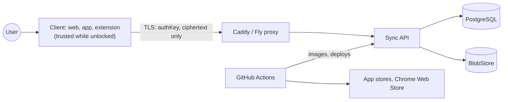

# Hearthkey Threat Model (v1, MVP scope)

Status: **Draft for review.** Method: STRIDE per component, with a data-flow view. Companion to the [crypto spec](crypto-spec.md). Reviewed again at Sprint 8 (MVP) and Sprint 13 (sharing and recovery).

## 1. Assets

| Asset | Why it matters |
| --- | --- |
| Master password | Root secret; derives everything |
| Decrypted vault data (passwords, notes) | The thing users trust us with |
| Keys in memory (user key, vault keys, private key) | Allow decrypting without the password |
| Wrapped keys and ciphertext on the server | Not directly useful to an attacker, but guessable offline if the password is weak |
| Authentication key and its server-side verifier | Allows account login if the key is stolen in transit |
| Session tokens, passkeys, TOTP secrets, recovery codes | Account takeover |
| Signing keys, deploy keys, secrets | Control over releases and infrastructure |
| Extension and app store listings, domain, DNS | Supply chain and phishing |

## 2. Actors

| Actor | Capability |
| --- | --- |
| Remote attacker | Internet access, can call the API, attempt phishing |
| Malicious website | Can run content in the browser the extension protects |
| Compromised server or insider (including a hosting provider) | Read the database, files, logs and network inside the host |
| Network attacker | Observe or modify traffic if TLS fails |
| Malware on the user's device | Reads memory, clipboard, keystrokes |
| Thief with a locked device | Physical access without unlock |
| Malicious dependency or build tool | Runs code in build or runtime |
| Curious or malicious family organizer/manager (post-MVP) | Approves recoveries, can read enrolled members' vaults |

## 3. Trust boundaries and data flow

Boundaries: (1) user device to network, (2) network to server, (3) server to storage, (4) CI to production and to the stores. Anything beyond the client boundary is untrusted for confidentiality of vault data.

## 4. Threats by component (STRIDE)

Legend: S spoofing, T tampering, R repudiation, I information disclosure, D denial of service, E elevation of privilege.

### 4.1 Cryptographic design and keys

| # | Threat | Cat | Mitigation | Residual |
| --- | --- | --- | --- | --- |
| C1 | Full database leak, offline guessing of master passwords | I | Argon2id with tuned parameters; server stores only a hash of a derived authentication key; strength meter; wrapped keys useless without the password | Weak passwords can still fall; user education |
| C2 | Nonce reuse or algorithm misuse | I, T | Random 192-bit nonces, libsodium only, AEAD with bound AD, known-answer tests, review | Implementation bugs; external review |
| C3 | Server swaps or replays ciphertexts between items, vaults or users | T | AD binds user, vault, item, type and revision | Rollback to an older valid revision by a malicious server is not prevented in MVP (see Q in review notes) |
| C4 | Downgrade of KDF parameters by a malicious or compromised server | I | Client enforces floor and ceiling; parameters come from versioned config | Floor must be kept current |
| C5 | Key material lingering in JavaScript memory | I | Short key lifetimes, `sodium_memzero`, no strings for keys, locking clears references | Cannot be fully eliminated in JS |
| C6 | Weak randomness | I | libsodium CSPRNG only; lint rule bans `Math.random` | Platform bugs |

### 4.2 Authentication and sessions

| # | Threat | Cat | Mitigation | Residual |
| --- | --- | --- | --- | --- |
| A1 | Credential stuffing, brute force of login | S | Rate limits per account and IP, lockout with backoff, passkey second factor, uniform errors | Distributed low-rate attacks |
| A2 | Account enumeration (sign-up, prelogin, login, reset) | I | Fake deterministic salts for unknown emails, uniform responses and timing | Timing side channels need testing |
| A3 | Phishing a lookalike site | S | Passkeys (domain-bound), extension fills only on exact registrable-domain match | Users who type the master password on a fake site; passkey still blocks login but not decryption of captured data on a fake client |
| A4 | Stolen session token | S, E | Short-lived access tokens, rotating refresh tokens, session list and revoke, re-authentication for sensitive actions | Token theft on a compromised device |
| A5 | Weak second-factor fallback (TOTP, recovery codes) | S | Recovery codes hashed server-side, single use, rate limited; passkeys recommended and later required for privileged roles | Fallback weaker than passkeys |
| A6 | Replay of captured `authKey` | S | TLS everywhere, HSTS, optional channel binding via tokens; `authKey` alone cannot decrypt the vault | A TLS-terminating attacker could log in but not decrypt (needs the password for the KEK) |

### 4.3 API and server

| # | Threat | Cat | Mitigation | Residual |
| --- | --- | --- | --- | --- |
| S1 | Broken object-level authorization (access another user's vault) | I, E | Deny by default, every query scoped to the authenticated principal, integration tests for cross-tenant access | Logic bugs; tests and review |
| S2 | Injection (SQL, header, log) | T, E | Zod validation, Drizzle parameterized queries, structured logging | Dependency vulnerabilities |
| S3 | Malicious or compromised server operator reads data | I | Zero-knowledge: only ciphertext and wrapped keys exist | Metadata (emails, sizes, timing) visible |
| S4 | Server pushes a malicious client (web app) to steal passwords | T, I | Web app served over HTTPS with strict CSP, Subresource Integrity, signed mobile apps and extension; users who need stronger guarantees use native/extension builds | A compromised web host can serve a malicious web client; inherent to web apps |
| S5 | Denial of service (request floods, large uploads) | D | Rate limits, body size and timeout limits from config, edge protection | Large volumetric attacks |
| S6 | Information leakage in logs or crash reports | I | No secrets, URLs or titles in logs; redaction layer; Sentry scrubbing; log reviews | Misconfiguration |
| S7 | Compromised secrets or deploy keys | E | Secrets outside the repo, least-privilege deploy key, environment secrets scoped, secret scanning | Developer workstation compromise |
| S8 | Lost or corrupted data | D | Nightly backups at a different provider, restore tests, point-in-time recovery for production | Recovery time |

### 4.4 Chrome extension

| # | Threat | Cat | Mitigation | Residual |
| --- | --- | --- | --- | --- |
| E1 | Malicious page tricks the extension into filling credentials | S, I | Exact registrable-domain match using the Public Suffix List; no fill in cross-origin iframes; confirmation on plain HTTP; user-visible fill UI | Compromised legitimate site |
| E2 | Page reads filled data or extension UI (clickjacking) | I | Closed shadow DOM where possible, fill on user gesture, minimal data to content script (one item) | Browser-level bugs |
| E3 | Extension compromise via supply chain or remote code | E | Manifest V3, no remote code, strict CSP, pinned dependencies, review of permissions | Malicious dependency update |
| E4 | Keys in service worker or storage exposed | I | Keys only in the service worker and `chrome.storage.session`, cleared on browser close and lock | Local malware |
| E5 | Malicious browser extension or user script reads the page | I | Out of our control; documented | Accepted |

### 4.5 Mobile and web clients

| # | Threat | Cat | Mitigation | Residual |
| --- | --- | --- | --- | --- |
| M1 | Lost or stolen unlocked device | I | Auto-lock, keystore-bound biometric unlock (later), remote session revoke | Window before lock |
| M2 | Malware reads clipboard or screen | I | Clipboard auto-clear, screenshot protection on sensitive screens | Accessibility-service malware |
| M3 | Device backups contain secrets | I | Exclude secure storage from backups | Platform behaviour |
| M4 | Web XSS steals keys | I, E | Strict CSP, no inline scripts, output encoding, no keys in `localStorage`, dependency auditing | Zero-days |
| M5 | Tampered app build | T | Signed releases, store review, provenance targets (SLSA) | Compromised signing keys |

### 4.6 Infrastructure and supply chain

| # | Threat | Cat | Mitigation | Residual |
| --- | --- | --- | --- | --- |
| I1 | Compromised dependency or build action | T, E | Lockfile, Renovate with digests, CodeQL, audit, minimal permissions, review of new dependencies | Novel supply-chain attack |
| I2 | VPS compromise | E, I | Hardened host, SSH keys only, firewall, no public database ports, patching, monitoring | Zero-days; mitigated by zero-knowledge design |
| I3 | Domain or DNS hijack | S | Registrar lock, 2FA, DNSSEC, CAA records, monitoring of certificates | Registrar account compromise |
| I4 | Staging used to attack production | E | Separate providers, separate secrets, no shared credentials, fake data only | Shared developer credentials |
| I5 | Repository compromise | T | Branch protection, required checks, signed commits where possible, secret scanning | Single-developer risk |

## 5. Deferred to later sprints (to be added before those features ship)
- Shared vaults: key distribution, fingerprint verification, removal and key rotation.
- Organizer/manager recovery: escrow, 24-hour wait, notification and cancellation, audit log, compromised approver.
- Passkey PRF unlock and biometric unlock.
- Attachments and SSL certificates (private key handling).

## 6. Review notes and open items
- Rollback or freeze by a malicious server (serving older valid ciphertexts) is not defended in the MVP; evaluate version vectors or signed vault heads before sharing ships.
- Timing differences in prelogin and login must be measured, not assumed.
- Revisit the web-client trust problem (S4) before launch; consider recommending the extension and native apps for high-risk users.
- Review OWASP ASVS L2 and MASVS L2 checklists against this model at each release gate.
